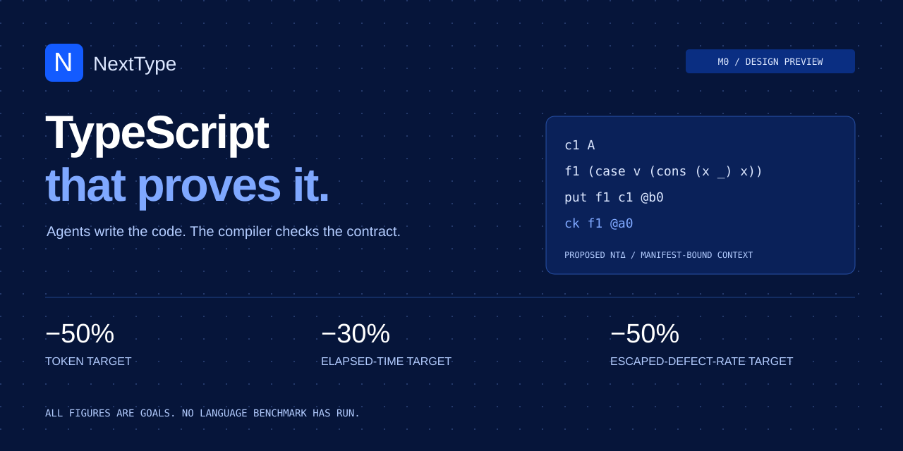

<p align="center"></p>

<p align="center">
  
  
  
</p>
<p align="center">
  
  
  
</p>

# NextType

**TypeScript that proves it.** Agents write the code. The compiler checks the contract. Humans review the spec.

An experimental execution language for agents.
Programs are typed compiler graphs.
Agents exchange compact patches and receive explicit obligations.
People approve intent and assumptions.
Independent machines check implementations against those fixed contracts.

**Current state: M0 design preview.**
The compiler, proof service, and autonomous repair controller remain planned.
The website contains browser fixtures and a scripted target animation.
There is no installable language release or measured performance result.

[Design documents](docs/README.md) · [Contribute](CONTRIBUTING.md) · [Governance](GOVERNANCE.md) · [Security](SECURITY.md)

## One fragment, one obligation

Proposed NTΔ under the manifest context `Γ = {A:U0, n:N, v:V A (S n)}`:

```text
c1 A
f1 (case v (cons (x _) x))
put f1 c1 @b0
ck f1 @a0
```

The index excludes an empty vector.
The compiler reconstructs the complete typed term before checking.
`@b0` identifies the base program; `@a0` identifies the independent approval envelope.
These are draft notation examples, not runnable commands.

## Autonomous within approved contracts

```text
approved intent -> typed patch -> proof check -> runtime tests -> accepted artifact
                         ^              |              |
                         +---------- bounded repair ---+
contract / authority / assumptions change -> owner approval -> new contract root
```

An implementation agent cannot weaken requirements, remove tests, add assumptions, or grant itself broader effects.
A proof establishes modeled properties under recorded assumptions.
It does not establish that the chosen requirement expresses the right intent.

## Compiler first, application targets downstream

```text
NTΔ -> NT0 -> check -> erase -> lower -> effect ABI
                                      -> JS / HTTP / UI / storage / CLI / jobs
```

TypeScript is the proposed initial tooling language.
Lean 4 is the proposed proof backend.
Next.js is one application adapter.
The first proof scope ends at the core model until preservation work closes the compiler gap.

## North star

| Goal | Target | Measurement |
| --- | --- | --- |
| Model-token demand | 50% lower | All tokens across all attempts per accepted change. |
| Elapsed time | 30% lower | End-to-end time for matched work, including checking and repairs. |
| Escaped defects | 50% lower rate | Independent evaluation of accepted changes. |

These figures are targets and scripted illustrations only.
CI rejection counts measure repair friction, not safety.
All comparisons retain fixed acceptance requirements and report failures.

## Planned repository

| Area | Responsibility |
| --- | --- |
| `schemas/`, `packages/core/` | Canonical terms, identities, contracts, and wire formats. |
| `packages/compiler/`, `verifier/` | Elaboration, obligations, proof checking, lowering, and preservation. |
| `packages/policy/`, `services/acceptance/` | Independent approval, bounded repair, and artifact acceptance. |
| `packages/runtime/`, `stdlib/`, `targets/` | Execution, reusable checked operations, and application bindings. |
| `tests/`, `benchmarks/` | Conformance, boundary failures, token accounting, and empirical evaluation. |
| `website/`, `visualization/`, `docs/` | Generated reference, transparent status, and foundational design. |

This table is a blueprint.
Implementation folders appear as their milestones begin.

## Contributing now

Review the semantics, challenge incomplete contracts, or propose a minimal conformance case.
Improve the benchmark design with reproducible comparisons.
Follow [CONTRIBUTING.md](CONTRIBUTING.md) and label planned capabilities accurately.

Licensed under the [Apache License 2.0](LICENSE).
Maintainers and release identifiers remain pending.
