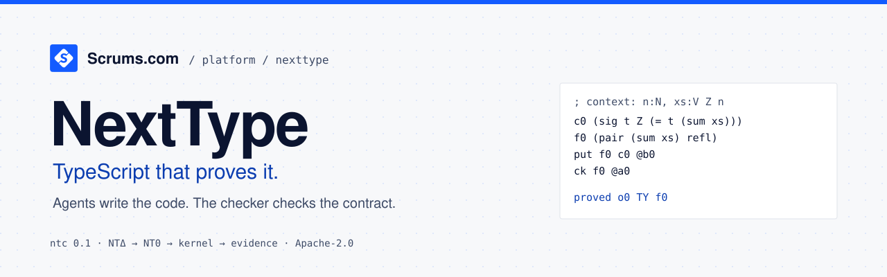

<p align="center">
  <a href="https://www.scrums.com/platform/nexttype"></a>
  <a href="docs/status.md"></a>
  <a href="../LICENSE"></a>
</p>

<p align="center">
  <a href="https://www.scrums.com/platform/nexttype">
    <picture>
      <source media="(prefers-color-scheme: dark)" srcset="assets/hero-dark.svg">
      <source media="(prefers-color-scheme: light)" srcset="assets/hero-light.svg">
      
    </picture>
  </a>
</p>

<p align="center">
  
  
</p>
<p align="center">
  
  
  
</p>

# NextType

**TypeScript that proves it.** Agents write the code. The compiler checks the contract. Humans review the spec.

An execution language for agents.
Programs are typed compiler graphs.
Agents exchange compact patches and receive explicit obligations.
People approve intent and assumptions.
Independent machines check implementations against those fixed contracts.

**Current state: design preview.**
The [`ntc` 0.1.0 reference checker](docs/tools/ntc.md) decodes NTΔ, elaborates it to the NT0 core, re-checks every term in an independent kernel, and binds each proved obligation to a digest.
There is no published release and no measured performance result.
See [Status](docs/status.md).

[Docs](docs/index.md) · [NTΔ shorthand](docs/language/shorthand.md) · [Quick reference](docs/reference/quick-reference.md) · [Patterns for agents](docs/guides/agent-patterns.md) · [Examples](examples/README.md) · [Benchmarks](benchmarks/README.md) · [Research](research/README.md) · [Contribute](../CONTRIBUTING.md#nexttype-nexttype) · [Governance](GOVERNANCE.md) · [Security](../.github/SECURITY.md#nexttype)

## Safety warning

NextType is pre-1.0.
Expect breaking changes between minor versions; each one is listed in the [changelog](CHANGELOG.md) with a migration note.
A manifest's constants are axioms: review them like a contract.
See the [security model](docs/reference/security-model.md) for what a `proved` result does and does not mean.

## Check a contract

Build the reference checker from a clone of [Scrumsdotcom/scrums](https://github.com/Scrumsdotcom/scrums) (Node.js 20 or later, no runtime dependencies):

```sh
cd nexttype/packages/compiler && npm ci --ignore-scripts && npm run build && cd ../..
alias ntc="node $PWD/packages/compiler/dist/src/cli.js"
```

Check the invoice example:

```console
$ ntc check --manifest examples/invoice/manifest.json examples/invoice/sum.ntd
proved o0 TY f0
; evidence sha256:c5ee1173d85575d1b4d30111b7f79c14e5a8af1a0f74b062a82e03e72a98ae2c
```

A wrong total is rejected:

```console
$ printf 'f0 (pair (add (sum xs) 1) refl)\nput f0 c0 @b0\nck f0 @a0\n' | ntc check --manifest examples/invoice/manifest.json
unknown o0 EQ f0
; 1:27 refl does not hold: (add (sum xs) 1) and (sum xs) are not definitionally equal; the checker cannot decide this equality
```

Learn the notation in [NTΔ shorthand](docs/language/shorthand.md).

## Install the preview CLI

> **Design preview.** This installs `nt`, a small preview script.
> It has no compiler, type checker, or prover.

For humans:

```sh
curl -fsSLO https://nexttype.dev/install.sh   # download
less install.sh                               # read it
sh install.sh                                 # run it
```

The installer downloads over HTTPS only and refuses any file whose SHA-256 differs from the value pinned in the installer.
Set `NT_VERIFY_PROVENANCE=1` to also require GitHub build provenance (needs `gh`).

For agents:

```sh
npx skills add https://github.com/Scrumsdotcom/scrums/tree/main/nexttype/skills/nexttype
```

This installs the [NextType agent skill](skills/nexttype/SKILL.md) with the [`skills`](https://github.com/vercel-labs/skills) CLI.
The skill tells the agent to install `nt` and to follow the habits below.
The CLI clones the repository with git. It needs no GitHub login.

- `nt guide` prints the guide: what NextType is, the two views, and how to write a contract.
- `nt proof init` writes a template obligation ledger, `PROOF.md`.
- `nt proof` checks that every obligation in the ledger has evidence recorded. It checks the ledger format only.

When using NextType: run `nt guide` to learn it, keep obligations in `PROOF.md`, and run `nt proof` before committing.
See [the CLI docs](docs/tools/cli.md).
Try `nt compare`, then `nt proof init` and `nt proof`.

## One fragment, one obligation

NTΔ under the context `Γ = {A:U0, n:N, v:V A (S n)}`:

```ntd
; context: A:U0, n:N, v:V A (S n)
; expect: proved o0 TY f1 @4
c1 A
f1 (case v (cons (x _) x))
put f1 c1 @b0
ck f1 @a0
```

The index excludes an empty vector, so the match needs no `nil` branch.
The checker reconstructs the complete typed term, then the kernel re-checks it.
`@b0` identifies the base program; `@a0` identifies the approval.
The `; expect:` line is the test data: CI runs this block.

## Autonomous within approved contracts

```text
approved intent -> typed patch -> proof check -> runtime tests -> accepted artifact
                         ^              |              |
                         +---------- bounded repair ---+
contract / authority / assumptions change -> owner approval -> new contract root
```

An implementation agent cannot weaken requirements, remove tests, add assumptions, or grant itself broader effects.
A proof establishes modeled properties under recorded assumptions.
It does not establish that the chosen requirement expresses the right intent.

## Compiler first, application targets downstream

```text
NTΔ -> NT0 -> check -> erase -> lower -> effect ABI
                                      -> JS / HTTP / UI / storage / CLI / jobs
```

TypeScript is the proposed initial tooling language.
Lean 4 is the proposed proof backend.
Next.js is one application adapter.
The first proof scope ends at the core model until preservation work closes the compiler gap.

## North star

| Goal | Target | Measurement |
| --- | --- | --- |
| Model-token demand | 50% lower | All tokens across all attempts per accepted change. |
| Elapsed time | 30% lower | End-to-end time for matched work, including checking and repairs. |
| Escaped defects | 50% lower rate | Independent evaluation of accepted changes. |

These figures are targets and scripted illustrations only.
CI rejection counts measure repair friction, not safety.
All comparisons retain fixed acceptance requirements and report failures.

## Repository layout

| Folder | Contents |
| --- | --- |
| `packages/compiler/` | The `ntc` reference checker: decoder, elaborator, kernel, evaluator. |
| `conformance/` | Positive and negative conformance cases for `ntd/1`. |
| `examples/` | Checked example streams and manifests, with readable views. |
| `docs/` | Documentation, published at nexttype.dev/docs. |
| `cli/`, `tests/` | The `nt` preview script, its installer, and their tests. |
| `benchmarks/`, `research/` | The benchmark design and the foundation paper. |

## Contributing now

Find a stream that `ntc` accepts but should reject: that is the most valuable report. See the [security policy](../.github/SECURITY.md#nexttype).
Review the semantics, challenge incomplete contracts, or propose a minimal conformance case.
Improve the benchmark design with reproducible comparisons.
Follow [CONTRIBUTING.md](../CONTRIBUTING.md#nexttype-nexttype) and the [code of conduct](../CODE_OF_CONDUCT.md), and label planned capabilities accurately.

Licensed under the [Apache License 2.0](../LICENSE).
Versioning follows [Versioning and stability](docs/reference/versioning.md).

## Credits

NextType is created by [Scrums.com](https://www.scrums.com), the Enterprise AI Platform for software engineering orchestration.
Maintainer: [Gerald Neves](https://github.com/gez-scrumsdotcom).
Organisation: [Scrumsdotcom](https://github.com/Scrumsdotcom).

## Links

- Documentation: [nexttype.dev/docs](https://nexttype.dev/docs)
- Current site: [nexttype.dev](https://nexttype.dev)
- NextType on Scrums.com: [scrums.com/platform/nexttype](https://www.scrums.com/platform/nexttype)
