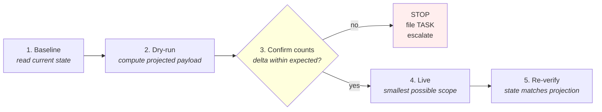

# Architecture

This document is the architectural framing for Company-as-Code. The authoritative source is [`docs/spec/company-as-code-spec.md`](./spec/company-as-code-spec.md). When they disagree, the spec wins.

---

## Layers

```
┌─────────────────────────────────────────────────────────────────┐
│  Executive cognition  — /company/executive                      │
│  Domain executives + CEO. Roll-up consumers, no autonomous       │
│  external writes.                                                │
├─────────────────────────────────────────────────────────────────┤
│  Domain modules  — /company/domains/<domain>/<module>           │
│  Owns tables, agents, workflows, dashboards, schemas.            │
├─────────────────────────────────────────────────────────────────┤
│  Sub-cognition modules  — <module>/sub-cognition/<name>          │
│  Recursive: identity, billing, deployment under platform; etc.   │
├─────────────────────────────────────────────────────────────────┤
│  Runtime + Observability  — /company/{runtime,observability,…}   │
│  Audit log + typed event ledger.                                 │
├─────────────────────────────────────────────────────────────────┤
│  Integrations  — /company/integrations                          │
│  Pluggable. Canonical IDs in; mappings out.                      │
└─────────────────────────────────────────────────────────────────┘
```

## Canonical primitives

| Primitive | Schema | Lives at |
|---|---|---|
| Module manifest | [`/schemas/manifest.schema.json`](../schemas/manifest.schema.json) | `<module>/manifest.yaml` |
| Agent | [`/schemas/agent.schema.json`](../schemas/agent.schema.json) | `<module>/agents/<name>.yaml` or `/company/agents/` |
| Workflow | [`/schemas/workflow.schema.json`](../schemas/workflow.schema.json) | `<module>/workflows/<name>.yaml` |
| Task | [`/schemas/task.schema.json`](../schemas/task.schema.json) | `<module>/tasks/<id>.yaml` or `/company/tasks/` |
| Initiative | [`/schemas/initiative.schema.json`](../schemas/initiative.schema.json) | `/company/initiatives/` |
| Goal | [`/schemas/goal.schema.json`](../schemas/goal.schema.json) | `/company/goals/` |
| Metric | [`/schemas/metric.schema.json`](../schemas/metric.schema.json) | `/company/metrics/` |
| Event | [`/schemas/event.schema.json`](../schemas/event.schema.json) | event ledger runtime |
| Audit record | [`/schemas/audit-record.schema.json`](../schemas/audit-record.schema.json) | audit log runtime |
| Interface | [`/schemas/interface.schema.json`](../schemas/interface.schema.json) | exposed in `manifest.exposes` |
| Organization | [`/schemas/organization.schema.json`](../schemas/organization.schema.json) | `/company/integrations/` or seeded |
| Person | [`/schemas/person.schema.json`](../schemas/person.schema.json) | `/company/integrations/` or seeded |
| Integration | [`/schemas/integration.schema.json`](../schemas/integration.schema.json) | `/company/integrations/` |
| Skill | [`/schemas/skill.schema.json`](../schemas/skill.schema.json) | `/company/skills/<name>.yaml` (generators emit per-runtime variants) |

## Modular monolith discipline

The repository is a modular monolith. The discipline:

1. Each module owns its business logic, data, agents, and invariants. Never move logic out of the module that owns it.
2. Cross-module communication happens only through declared interfaces. Imports from another module's internals are forbidden.
3. Every new module requires a manifest before any code is written.
4. Infrastructure layers contain zero business logic — capabilities only.
5. State mutation is unidirectional. All state changes originate from the coordination layer; downstream systems read.

CI enforces (1), (3), and the manifest contract for (2) via the dependency-graph generator.

## Cognition tree

The repository is an **executable organizational graph**, not an org chart.

```mermaid
flowchart TD
    CEO[ceo<br/><i>executive cognition</i>]
    FE[finance-ops<br/><i>executive</i>]
    PE[product-operations<br/><i>executive</i>]
    SE[sales-marketing<br/><i>executive</i>]

    CEO --> FE
    CEO --> PE
    CEO --> SE

    FE --> FIN[finance]
    FE --> LEG[legal]
    FE --> PEO[people]
    FE --> SUP[suppliers]
    FE --> OPS[operations]
    FE --> GOV[governance]
    FE --> INFR[infra]
    FE --> REP[reporting]

    PE --> WEB[web]
    PE --> PROD[products]
    PE --> PLAT[platform]
    PE --> DEL[delivery]
    PE --> ARCH[architecture]
    PE --> SEC[security]
    PE --> QA[qa]
    PE --> REL[reliability]
    PE --> DOC[documentation]

    PLAT --> IDN[identity]
    PLAT --> BIL[billing]
    PLAT --> DEP[deployment]

    SE --> MKT[marketing]
    SE --> SAL[sales]
    SE --> CUST[customer]
    SE --> PAR[partnerships]
    SE --> GRW[growth]
    SE --> BRD[brand]
    SE --> CON[content]
    SE --> ROP[revenue-operations]

    style FIN stroke-width:3px
    style PLAT stroke-width:3px
    style GRW stroke-width:3px
    style IDN stroke-dasharray: 3 3
    style BIL stroke-dasharray: 3 3
    style DEP stroke-dasharray: 3 3
```



> Bold-bordered nodes are the worked example modules in this seed. Dashed-bordered nodes are sub-cognition modules under their parent.

Each node supports scoped memory, tools, workflows, dashboards, observability, permissions, tasks, automation, context windows.

A folder without a manifest declares no logic — it is an organizational placeholder. A folder with a manifest is a real module subject to the discipline above.

## Generated registries + drift gate

Manifests are walked by deterministic generators that emit:

- **`/generated/agent-catalogue.json`** — every autonomous unit
- **`/generated/flow-registry.json`** — every workflow with trigger + HITL flag
- **`/generated/dependency-graph.json`** — module-to-module interface edges
- **`/generated/domain-model.json`** — module ownership of tables and schemas
- **`/generated/context-bundles/<module>__<agent>.json`** — per-agent typed runtime context, resolved from the agent declaration plus the owning module's exposes/consumes/invariants
- **`/generated/skill-index.json`** — flat index of every defined skill with autonomy class, owner, tags, related skills
- **`/generated/skills/{claude,agents-md,gemini}/...`** — per-runtime skill adapters generated from `/company/skills/*.yaml`

CI runs `npm run generate:check` on every PR. If any generated file would change but isn't in the diff, CI fails. Hand-merging generated files is forbidden — when conflicts arise, regenerate.

## Canonical IDs

Internal IDs are permanent. External system IDs live under `externalIds` arrays and are evolutionary.

- When an external tool is replaced, only the mapping changes — canonical IDs survive.
- When entities are merged, canonical IDs are stable; the merge is recorded against them.
- Soft-delete with a tombstone is mandatory. Hard-delete is forbidden.

## Coordinate, don't replicate

The coordination layer holds canonical IDs, system mappings, state machines, orchestration metadata. It is **not** a mirror of every SaaS database.

- Authoritative data stays in the system that originates it.
- Fields belonging to a specific external system are read on demand or mirrored sparsely.
- If a field can be derived, it is derived, not stored.

## Unidirectional mutation

Every field has exactly one writer. Bidirectional sync is a defect, not a feature.

- A sync into the coordination layer flows one direction.
- A writeback to an external system is one direction and gated by an explicit operational action (typically HITL).
- Round-trip fields require an explicit conflict-resolution protocol — written down, not implied.

## Autonomy classification

Every executable action declares its autonomy:

- **autonomous** — fires without human intervention (read-only syncs, validation, registry generation)
- **human-gated** — requires explicit human action (writebacks, irreversible changes, financial actions)
- **escalated** — fires autonomously up to a threshold, then escalates (retries, error budgets, dunning)

The classification is declarative in the manifest. The runtime enforces it. Schedules attached to `human-gated` workflows fail validation.

## Dry-run

Every write path supports `dryRun=true`. The first invocation of any new write path defaults to dry-run.

- All validation runs, the full payload is computed
- An audit record is written
- No external mutation occurs
- The payload is returned for review

The [sync verification protocol](#sync-verification-protocol) standardizes how operators use dry-run.

## HITL invariants

Human-in-the-loop is a declaration on the manifest, the agent, or the workflow. Not a comment in prose.

- The manifest declares: "this writeback fires only from human action in this admin surface"
- The agent declaration declares: "cadence: on-demand; never scheduled"
- The runtime enforces the declaration — schedules attached to an HITL-declared workflow fail validation

## Audit log + typed event ledger

Two distinct surfaces. Not interchangeable.

| | Audit log | Typed event ledger |
|---|---|---|
| Granularity | One row per orchestration action | One row per state transition on a canonical entity |
| Schema | Loose: actor, action, payload, status, duration | Tight: entity, event type (enum), payload |
| Used for | Debugging, post-hoc reasoning, compliance | Replay, derived state, dashboards, agent reasoning |
| Adding a new type | Free | Requires migration + enum update |

Every mutation writes a typed event. Every action writes an audit row. Nothing escapes both.

## Sync verification protocol

Every state-mutating sync follows the same five steps, regardless of which systems are involved:



1. **Baseline** — query current state, record counts/IDs/hashes
2. **Dry-run** — execute with `dryRun=true`, inspect projected payload
3. **Confirm counts** — compare projected delta to baseline; stop if wildly off
4. **Live** — execute with `dryRun=false`, smallest possible scope
5. **Re-verify** — re-query baseline, confirm state shifted as predicted

The audit log captures this as a queryable narrative under a single correlation ID. Agents that follow this protocol are auditable in the same way humans are.

See the [`sync-verification`](../company/skills/sync-verification.yaml) skill for the canonical operationalization.

## Observability

Everything emits logs, events, traces, metrics, alerts. Metrics declare ownership, lineage, freshness, formula, thresholds. Dashboards surface bottlenecks, throughput, blocked work, SLA failures, organizational risk.

## Knowledge model

Three tiers:

- **Tier 1 — Context** — long-form narrative; lives in wiki-style documents and ADRs
- **Tier 2 — Runtime entry-points** — numbered steps, inputs, outputs, definition-of-done; lives in tasks, workflows, runbooks
- **Tier 3 — Skills** — composable, reusable expertise referenced by name; lives at [`/company/skills/`](../company/skills) as canonical YAML, validated by [`/schemas/skill.schema.json`](../schemas/skill.schema.json)

Mixing tiers is the most common documentation failure mode. Migration from legacy wiki dumps classifies each document, extracts each tier, archives the original.

### Skills as one primitive, many runtimes

Skills are the most cross-cutting Tier-3 artefact. One canonical YAML at `/company/skills/<name>.yaml` is walked by the generator into per-runtime adapters under `/generated/skills/`:

- **`claude/<name>/SKILL.md`** — Claude Code skill format (YAML frontmatter + markdown body)
- **`agents-md/<name>.md`** — provider-neutral markdown for Codex, Cursor, Aider, Continue, AGENTS.md-aware tools
- **`gemini/<name>.gem.json`** — Gemini Gems format (also a workable shape for OpenAI Assistants)

Forks add a fourth adapter (LangChain hub, custom IDE rules, …) by writing one small function in `cli/src/generate.ts`. The canonical YAML never changes. The drift gate protects all generated outputs equally.

Agents declare which skills they may invoke via the optional `skills:` field on the agent manifest. Cross-document validation rejects agent references to undefined skills and skill references to undefined related skills.

## AI-native design

- **Structured context bundles** are generated per agent — typed, scoped, deterministic
- **Persistent agent memory** is a versioned layer distinct from documentation
- **Adversarial verification posture** — recalled information is a claim until checked against current state
- **Autonomy classification** is declared and enforced per action

The context-bundle pipeline is to AI runtimes what the build system is to compiled software.

## Anti-patterns

- Nothing built on dirty data
- No silent destruction (no hard-delete, no silent merge, no overwrite without read)
- No hand-merging of generated files
- No force-push to protected branches
- No vendor lock-in
- No autonomous writes to irreversible surfaces
- No replication as a substitute for coordination
- No tribal-knowledge runbooks
